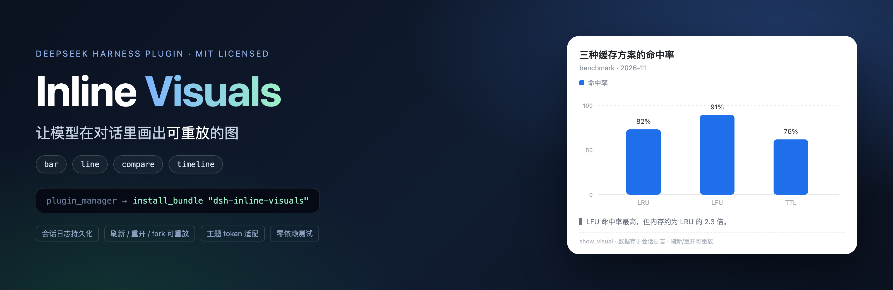
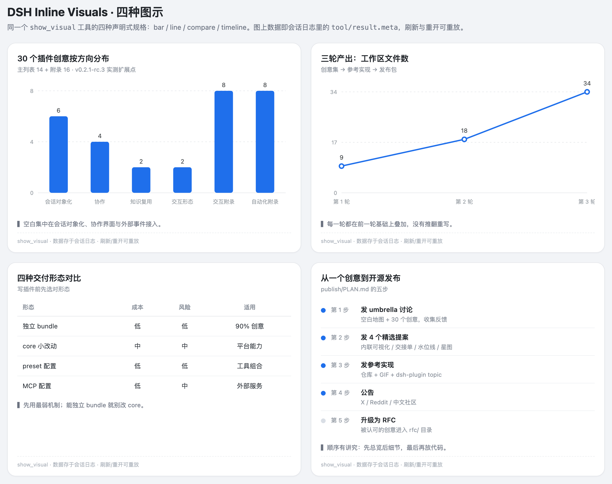
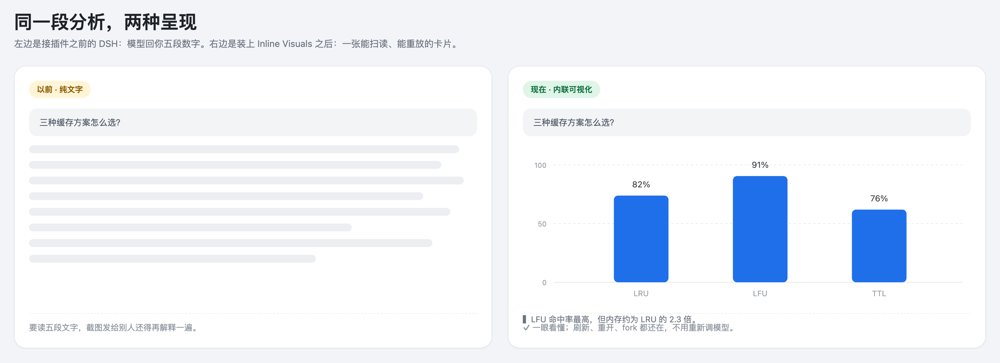
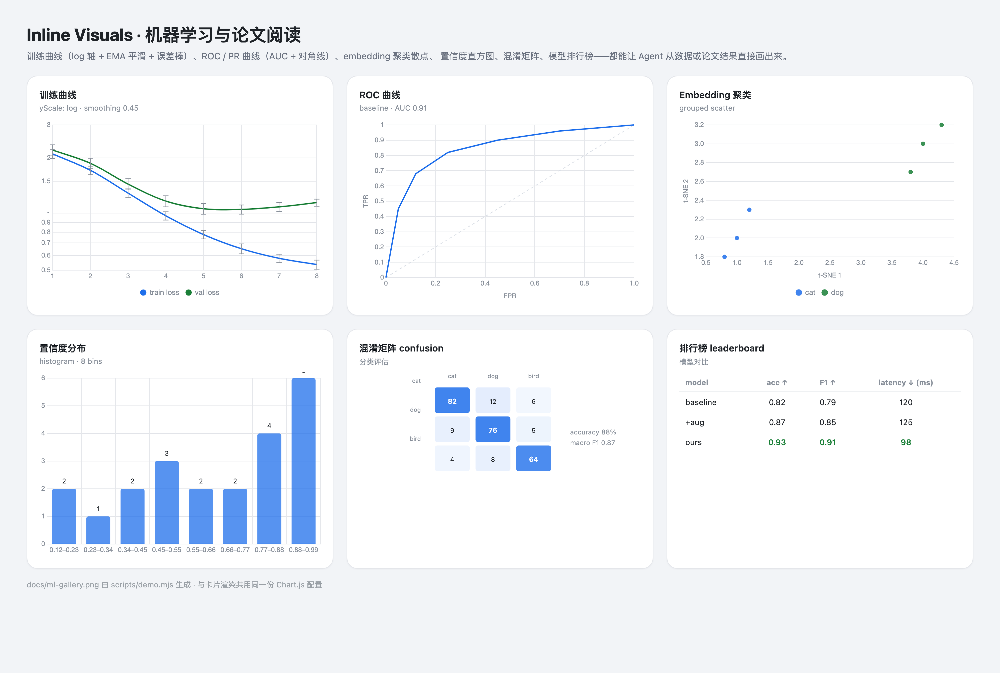

# Inline Visuals

**English** · [简体中文](README.zh.md)



### Charts your agent can draw — and your session can replay. 

A plugin for [DeepSeek Harness](https://deepseek-harness.github.io/deepseek-harness/) that turns
numbers into pictures **inside the conversation**: 18 kinds of charts, tables, timelines, gantt,
heatmaps, flows and KPI tiles — plus ML/paper visuals such as training curves, ROC/PR curves,
confusion matrices, leaderboards and embedding clusters. With styles, exports and click-to-ask.

[](LICENSE)
[](https://deepseek-harness.github.io/deepseek-harness/)
[](#what-it-can-draw)
[](https://github.com/YLifeOnlyOnce/dsh-inline-visuals/actions/workflows/ci.yml)



## Why you'll like it

- **Figures in the answer, not just the tool log.** The final chart of a turn lands beneath the reply.
- **See it, don't read it.** "Three caching strategies, compared" becomes a card you scan in two seconds.
- **It stays.** The card is stored in the session log — refresh, reopen, branch the session, it is still there.
- **Ask, don't retype.** Click any data point, get a one-click follow-up prompt in your composer.
- **Change it by talking.** "Make it horizontal and stacked, with labels." The agent patches the chart
  with `edit_visual` instead of redrawing everything.
- **Native and safe.** Follows the host theme (light/dark, English/Chinese). The model sends *data*,
  never HTML or JavaScript.
- **Made for ML & papers.** Training curves with log axes, smoothing and error bars; ROC/PR with AUC;
  confusion matrices; model leaderboards; embedding clusters; histograms.
- **Made to share.** Copy JSON/CSV, export PNG or SVG.

## Install in 30 seconds

Inside a DSH session, paste one line:

```text
plugin_manager({ action: "install_bundle", target: "dsh-inline-visuals" })
```

No clone, no configuration. You should see `show_visual` (and `edit_visual`) among your agent's tools.

> Requires DeepSeek Harness `v0.2.1-rc.3` or newer. Prefer source? Use
> `github:YLifeOnlyOnce/dsh-inline-visuals`, or point Plugin Manager at a local clone
> (see the [technical reference](docs/reference.md)).

## Try it

Just talk to your agent:

> **"Compare three caching strategies — hit rate, memory and complexity — as a chart."**

> **"Turn that into a horizontal stacked bar, and add value labels."**

> **"Draw our release pipeline as a flow."**

> **"Show last week's traffic as a heatmap."**

## What it can draw

| | |
|---|---|
| **Charts** | bar · line · area · pie · doughnut · scatter · radar · waterfall |
| **ML & papers** | training curves · ROC/PR curves · confusion matrix · histogram · model leaderboard · embedding scatter |
| **Everything else** | compare table · timeline · gantt · heatmap · flow · KPI tiles |

Every visual accepts presentation **styles**: horizontal or stacked bars, stepped lines, data labels,
legends, grids, five palettes, height and density, scatter trend lines, log axes, EMA smoothing and
error bars.




## Built for ML & paper reading



Reading a paper or a training log? Ask for the figure:

> **"Plot train/val loss for 8 epochs on a log scale, smoothed, with error bars."**

> **"Draw the ROC curve from these points and mark AUC."**

> **"Make a confusion matrix for cat/dog/bird from this table."**

> **"Compare these four models on accuracy, F1 and latency — highlight the best."**

> **"Cluster these embeddings by class and show a t-SNE scatter."**

## How it works (in one breath)

The model sends a small, declarative spec → the plugin validates and stores it on the tool result →
your client renders it with the host's theme. Because the data lives in the session log, replays need
no extra model call.

## FAQ

**Do I need to configure anything?** No. Install and ask.

**Where do the cards live?** In the session log (`tool/result.meta`), not in a separate file.

**Does it send my data anywhere?** No. The plugin performs no network calls; the model already sees
what you typed.

**Can I get the numbers out?** Copy as JSON or CSV; charts export as PNG; hand-drawn cards as SVG.

**Which kinds are interactive?** Click-to-ask works on chart kinds (canvas). More surfaces are on the
roadmap.

**Text-only clients?** They receive a compact text summary instead of the card — nothing is lost.

## Under the hood

- 38 tests (`node:test`), CI on every push, tag-driven npm release with provenance.
- ~35 KB host half, one self-contained browser file (~217 KB, Chart.js inlined, React shared with the host).
- Spec `version: 3` is stable; v1/v2 specs still render.

Full parameter reference, limits and development notes: **[docs/reference.md](docs/reference.md)**.
Changelog: [CHANGELOG.md](CHANGELOG.md). Contributing: [CONTRIBUTING.md](CONTRIBUTING.md).

## License

[MIT](LICENSE) © 2026 YLifeOnlyOnce
