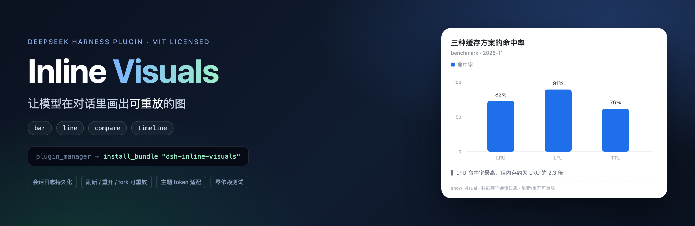
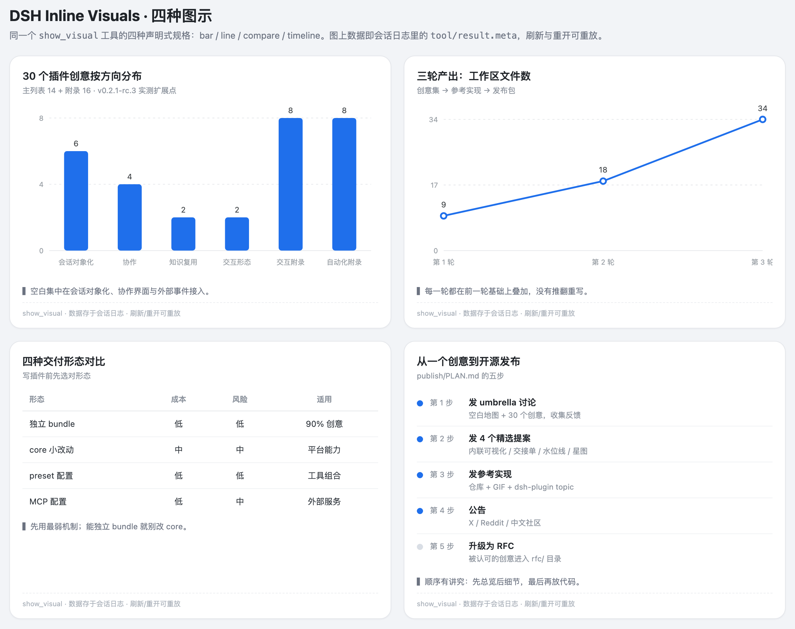
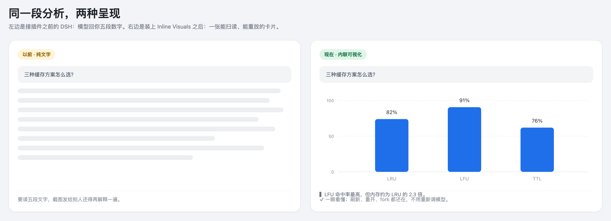
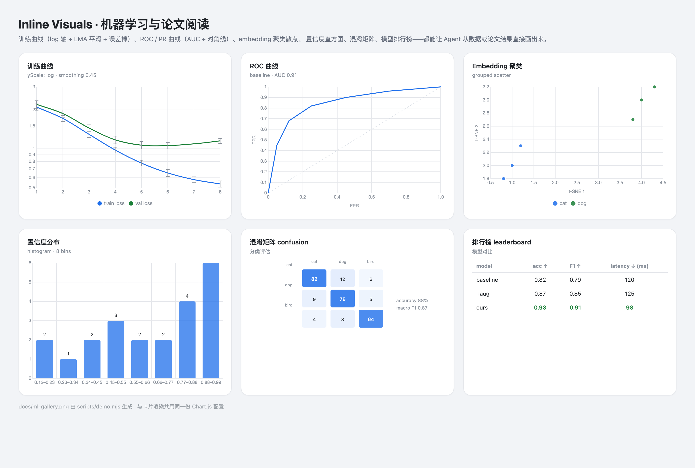

# Inline Visuals · 内联可视化

[English](README.md) · **简体中文**



### 让模型在对话里画出可重放的图。

一个 [DeepSeek Harness](https://deepseek-harness.github.io/deepseek-harness/) 插件：把数字变成**对话里的图**——
柱状图、折线图、对比表、时间线、甘特图、热力图、流程图、KPI 卡片，共 **18 种**，还支持样式调整、导出、点一下就能追问，并为机器学习与论文阅读做了专门优化。

[](LICENSE)
[](https://deepseek-harness.github.io/deepseek-harness/)
[](#它能画什么)
[](https://github.com/YLifeOnlyOnce/dsh-inline-visuals/actions/workflows/ci.yml)



## 为什么你会喜欢它

- **图在正文里，不只在工具日志里。** 每轮最后一张图会出现在回答正文下方。
- **一眼看懂，而不是读五段文字。** 「三种缓存策略怎么选」直接变成一张能扫读的卡片。
- **图会一直在。** 卡片存在会话日志里——刷新、重开、fork 之后还在。
- **想问就问。** 点一下图上的数据点，输入框自动出现一条针对性的追问。
- **说一句就能改。** 「改成横向、堆叠、加数值」——Agent 用 `edit_visual` 打补丁，而不是重画整张图。
- **原生、安全。** 跟随宿主主题（深浅色、中英文）；模型提交的是**数据**，不是 HTML/JS。
- **为 ML 和读论文而生。** 训练曲线（log 轴 + 平滑 + 误差棒）、ROC/PR（AUC + 对角线）、
  混淆矩阵、模型排行榜、embedding 聚类散点、置信度直方图。
- **方便分享。** 复制 JSON/CSV，导出 PNG/SVG。

## 30 秒安装

在 DSH 会话里贴一行：

```text
plugin_manager({ action: "install_bundle", target: "dsh-inline-visuals" })
```

不用 clone、不用配置。看到 `show_visual`（和 `edit_visual`）出现在工具列表里就成功了。

> 需要 DeepSeek Harness `v0.2.1-rc.3` 或更高版本。想从源码装？用
> `github:YLifeOnlyOnce/dsh-inline-visuals`，或把本地 clone 的绝对路径交给 Plugin Manager
> （见[技术参考](docs/reference.zh.md)）。

## 试试看

直接对模型说：

> **「把三种缓存策略的命中率、内存和复杂度画成图。」**

> **「改成横向堆叠，再打开数值标签。」**

> **「把我们的发布流程画成流程图。」**

> **「上周的流量用热力图看一下。」**

## 它能画什么

| | |
|---|---|
| **图表** | bar · line · area · pie · doughnut · scatter · radar · waterfall |
| **ML / 论文** | 训练曲线 · ROC/PR 曲线 · 混淆矩阵 · 直方图 · 模型排行榜 · embedding 散点 |
| **其他** | 对比表 · 时间线 · 甘特图 · 热力图 · 流程图 · KPI 卡片 |

每张图都支持**样式**：横向/堆叠、阶梯线、数值标签、图例、网格、5 套配色、高度/密度、散点趋势线、
log 轴、EMA 平滑、误差棒。




## 为机器学习与论文阅读而生



读论文或看训练日志时，直接让 Agent 画：

> **「把 8 个 epoch 的 train/val loss 画成 log 轴、带平滑和误差棒的曲线。」**

> **「用这些点画 ROC 曲线，标出 AUC。」**

> **「把这个表格画成 cat/dog/bird 的混淆矩阵。」**

> **「对比这四个模型的 accuracy、F1 和延迟，标出最好的。」**

> **「把这些 embedding 按类别聚类，画 t-SNE 散点。」**

## 它是怎么工作的（一句话）

模型提交一份很小的声明式规格 → 插件校验并写进工具结果 → 你的客户端用宿主主题把它渲染出来。
因为数据在会话日志里，重放不需要再调一次模型。

## 常见问题

**要配置什么吗？** 不用，装完直接问。

**图存在哪？** 会话日志（`tool/result.meta`），不是单独的文件。

**会把我的数据发到别处吗？** 不会。插件不发网络请求；模型本来就看到了你输入的内容。

**能导出数字吗？** 可以复制 JSON/CSV；图表导出 PNG，自绘卡片导出 SVG。

**哪些图能点选？** 目前 Chart.js 图型支持点选追问，其他类型在路线图里。

**纯文本客户端呢？** 会收到紧凑的文字摘要，内容不丢。

## 工程与可信度

- 38 个测试（`node:test`），每次 push 跑 CI，tag 触发 npm 发布（带 provenance）
- Host 半约 35 KB；浏览器半是单文件（约 217 KB，Chart.js 内联，React 与宿主共享）
- 规格 `version: 3` 已冻结，v1/v2 旧规格仍可渲染

完整参数、限制与开发说明：**[docs/reference.zh.md](docs/reference.zh.md)**（[English reference](docs/reference.md)）。
更新日志 [CHANGELOG.md](CHANGELOG.md) · 贡献指南 [CONTRIBUTING.md](CONTRIBUTING.md)。

## License

[MIT](LICENSE) © 2026 YLifeOnlyOnce
