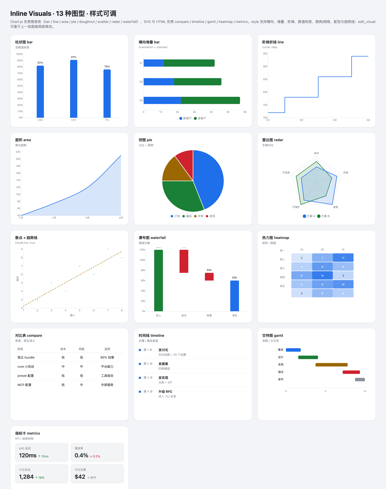

# Discussion draft (English)

> For DSH GitHub Discussions / Show and tell. Images reference `../docs/`.

## Title

**Plugin: Inline Visuals — replayable charts the model can draw (13 kinds)**

## Body

**Scenario.** I asked for a comparison of three caching strategies and got five paragraphs of numbers.
I wanted a chart I could scan — and I wanted it to still be there when I reopened the session next week.

**What I built.** A DSH plugin: one model-facing tool (`show_visual`) plus one tool-card renderer.



- **13 kinds**: bar / line / area / pie / doughnut / scatter / radar (Chart.js), plus compare / timeline /
  gantt / metrics (hand-written SVG/HTML);
- the model submits a **declarative spec** (data, not HTML/SVG); the Host normalizes/clips it and persists
  it through `output.presentationMeta` onto `tool/result.meta`;
- the Client registers a renderer in `tool.call.toolview` keyed by the tool name and renders with
  `--dsw-alias-*` theme tokens;
- because the data lives in the session log, **refresh / reopen / fork render the same card** without
  another model call;
- non-Web clients get a compact text fallback.

**Install** (DSH ≥ v0.2.1-rc.3):

```text
plugin_manager({ action: "install_bundle", target: "@oi-yao/dsh-inline-visuals" })
```

From GitHub (no npm publish needed): `target: "github:YLifeOnlyOnce/dsh-inline-visuals"`.

**Engineering**: `src/` + esbuild build, 12 `node:test` cases, GitHub Actions CI, tag-triggered npm
provenance publishing and a GitHub Release carrying the tarball. MIT.

**Feedback wanted**: which kind should v0.3 add first — heatmap, flow or sankey? What is missing on the card?

Repo: https://github.com/YLifeOnlyOnce/dsh-inline-visuals
