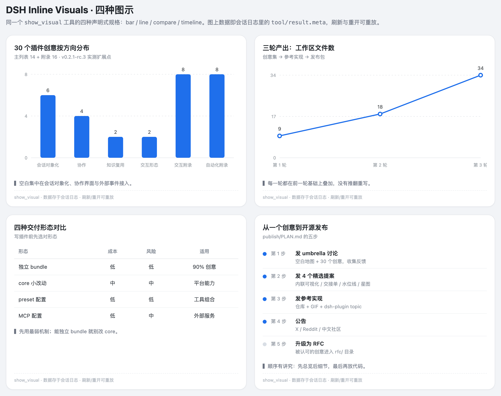
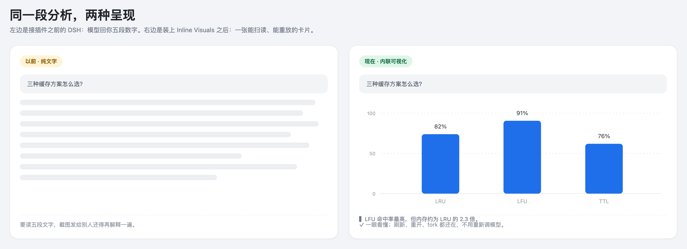

# 社区讨论稿（中文）

> 目标：DSH GitHub Discussions / 中文社区。配图引用仓库内 `../docs/`。

## 标题

**插件分享：Inline Visuals —— 让模型在对话里画出可重放的图（14 种图型）**

## 正文

**场景**：我让模型比较三种缓存策略，它回了五段数字。我想要一张能扫读的图，而且下周重开会话时它还在。

**做了什么**：一个 DSH 插件 `show_visual` + 一个工具卡片渲染器。



- 14 种图型：bar / line / area / pie / doughnut / scatter / radar（Chart.js）+ compare / timeline / gantt / metrics（自绘 SVG/HTML）；
- 模型只提交**声明式规格**（不是 HTML/SVG 代码），Host 校验裁剪后通过 `output.presentationMeta` 存进 `tool/result.meta`；
- Client 在 `tool.call.toolview` 按工具名注册渲染器，颜色全部来自 `--dsw-alias-*` 主题 token；
- 因为数据在会话日志里，**刷新、重开、fork 都能重放**，不需要再调模型；
- 非 Web 客户端（TUI/日志/导出）会收到紧凑的文字回退。



**安装**（DSH ≥ v0.2.1-rc.3）：

```text
plugin_manager({ action: "install_bundle", target: "dsh-inline-visuals" })
```

也可以从 GitHub 装：`target: "github:YLifeOnlyOnce/dsh-inline-visuals"`。

**工程化**：`src/` + esbuild 构建、12 个 node:test 测试、GitHub Actions CI、tag 触发 npm provenance 发布、GitHub Release 附带 tarball。MIT。

**想听反馈**：v0.3 先加 heatmap、flow 还是 sankey？卡片上还缺什么信息？

仓库：https://github.com/YLifeOnlyOnce/dsh-inline-visuals
